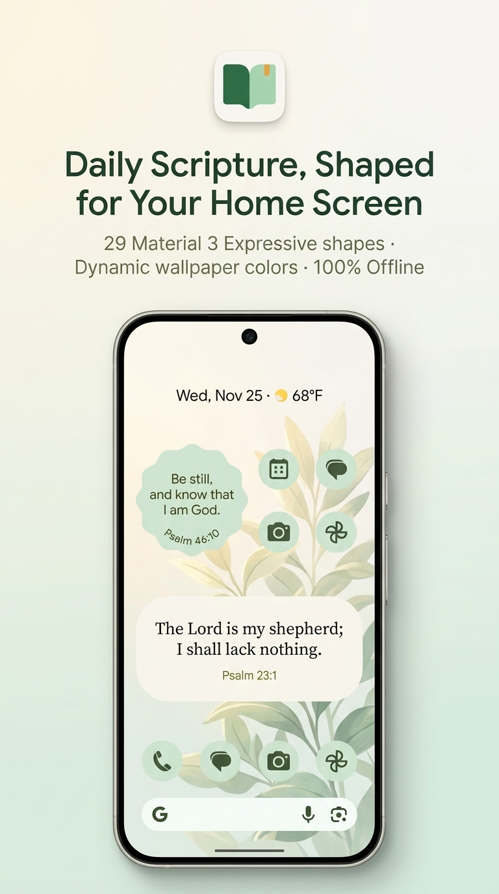
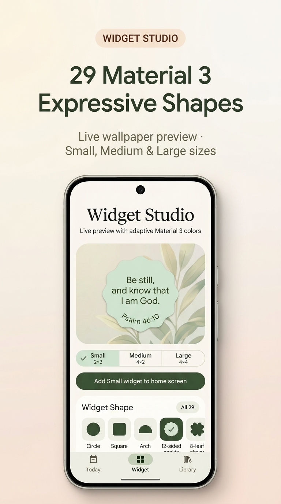
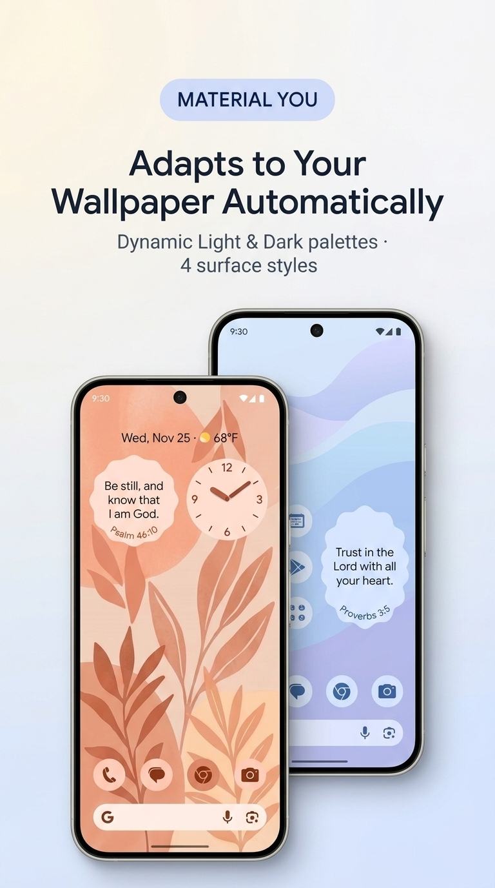
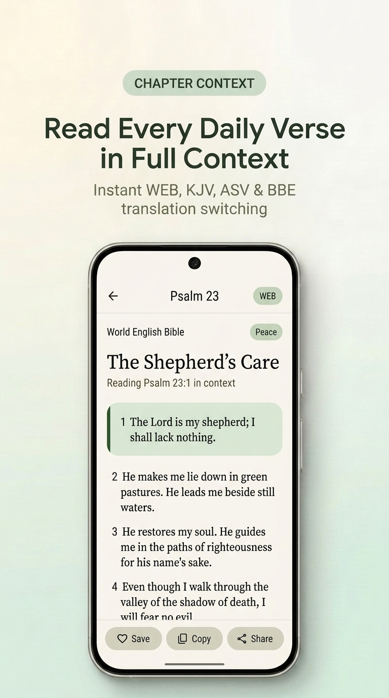
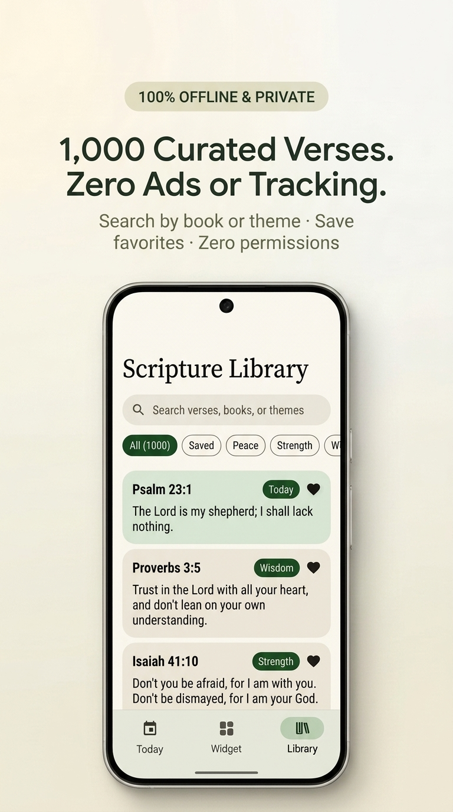
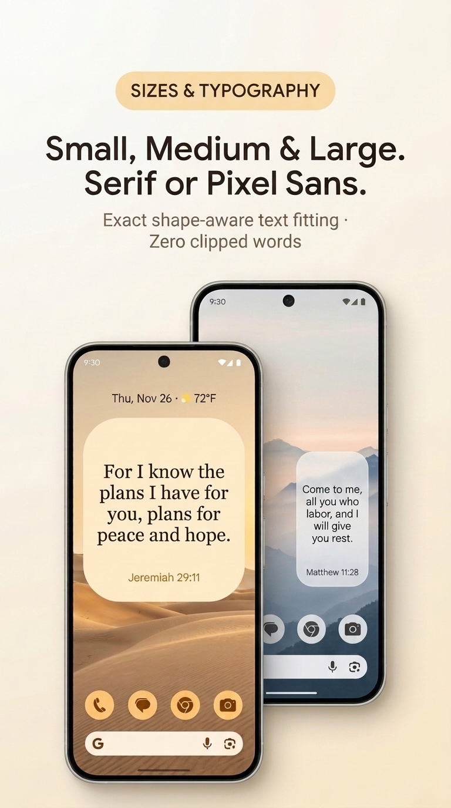

<div align="center">
  

  <h1>Selah — Daily Bible Verse & Material 3 Expressive Widget</h1>

  <p>
    <strong>A calm, 100% offline, open-source daily Bible verse app and Material You home screen widget for Android.</strong><br />
    29 borderless Material Design 3 Expressive shapes · 1,000 curated verses · 4 public-domain translations · Zero permissions, zero ads, zero tracking.
  </p>

  <p>
    
    
    
    
    
  </p>

  <p>
    <a href="#-download-apk">Download APK</a> •
    <a href="#-highlights">Highlights</a> •
    <a href="#-29-material-design-3-expressive-shapes">29 Expressive Shapes</a> •
    <a href="#-offline-scripture-library">Offline Library</a> •
    <a href="#-building-from-source">Build & Release</a>
  </p>

  <br />

  <p align="center">
    
    
    
  </p>
  <p align="center">
    
    
    
  </p>
</div>

---

## ✨ About Selah

**Selah** is a minimalist, privacy-first **daily Bible verse app and Android home screen widget** designed to feel native on Google Pixel and Material You devices. Whether you are looking for a clean **Bible verse of the day widget**, an **offline scripture reader with chapter context**, or a **Material 3 Expressive Android widget** that automatically adapts to your wallpaper colors, Selah delivers a quiet, distraction-free daily reading experience—completely offline and free of ads, accounts, or analytics.

---

## 📲 Download APK

You can install Selah directly on any Android 7.0+ (API 24+) device—no Google Play account required:

1. Open the **[Releases](../../releases/latest)** page on this GitHub repository.
2. Under **Assets**, download the latest `Selah-v*.apk` file.
3. Tap the downloaded APK on your Android phone and approve installing from your browser or file manager.

> **Verify integrity:** Every automated GitHub Release includes a `SHA256SUMS.txt` file so you can verify the APK checksum before installing.

---

## 🌟 Highlights

- **29 Material Design 3 Expressive Shapes:** Personalize your home screen with borderless, edge-to-edge M3 Expressive shapes—including circles, rounded squares, arches, semicircles, tilted ovals and pills, cookies, clovers, suns, bursts, flowers, and more.
- **Exact Shape-Aware Typography:** A custom scanline contour engine fits every verse inside the true interior geometry of all 29 shapes across **Small (2×2)**, **Medium (4×2)**, and **Large (4×4)** widgets—with **zero cropped words** and automatic font scaling.
- **Curved Bottom-Arc References:** On circular and scalloped shapes, the book, chapter, and verse reference curves smoothly along the bottom contour and tucks in naturally on shorter verses.
- **Pixel-Identical Home Screen Fonts:** Uses bundled **Google Sans Flex** (matching official Google Pixel widgets) and **Newsreader** editorial serif rendered identically in both the in-app Widget Studio and your home screen launcher.
- **Material You Dynamic Wallpaper Colors:** Adapts automatically to your Android 12+ wallpaper palette (Light & Dark themes), with 4 surface styles (*Dynamic Tonal*, *Expressive Accent*, *Crisp Contrast*, and *Soft Translucent*) and darker Material 3 Expressive accent colors for book/chapter/verse references.
- **1,000 Curated Verbatim Verses (100% Offline):** Every verse is self-contained, meaningful for daily reflection, and verified verbatim across **4 public-domain Bible translations** with full surrounding chapter context.
- **Radical Privacy by Design:** Requires **zero Android permissions**—not even `INTERNET`. Everything stays 100% on your device.

---

## 🎨 29 Material Design 3 Expressive Shapes

Browse all 29 shapes live in **Widget Studio** via the horizontal carousel or the full **All 29** gallery sheet, complete with one-tap widget pinning and real-time wallpaper previews:

| Category | Included Shapes |
| :--- | :--- |
| **Classic & Geometric** | Circle · Square · Slanted · Arch · Semicircle · Oval · Pill |
| **Angular & Sculpted** | Triangle · Arrow · Fan · Diamond · Clamshell · Pentagon · Gem |
| **Cookies & Clovers** | 4-sided cookie · 6-sided cookie · 7-sided cookie · 9-sided cookie · 12-sided cookie *(default)* · 4-leaf clover · 8-leaf clover |
| **Radiant & Playful** | Very sunny · Sunny · Burst · Soft burst · Flower · Puffy · Ghost-ish · Bun |

Every shape is normalized edge-to-edge to fill your launcher's widget cell cleanly without excess outer margins or borders, and smoothly adapts to **2×2 Small**, **4×2 Medium**, and **4×4 Large** sizes.

---

## 📖 Offline Scripture Library

Selah bundles a compressed, fast-loading offline corpus of **1,000 standalone verses** spanning both the Old and New Testaments:

- **4 Public-Domain Translations** (instant switching in the reader and widget):
  - **WEB** — World English Bible *(clear modern English)*
  - **KJV** — King James Version *(classic 1611 cadence)*
  - **ASV** — American Standard Version *(faithful early-modern prose)*
  - **BBE** — Bible in Basic English *(calm, accessible phrasing)*
- **Full Chapter Context:** Tap your home screen widget or any verse in the app to read the surrounding passage with the daily verse highlighted.
- **Daily Rotation Without Repeats:** Deterministically rotates every midnight across the full year without repeating verses.
- **Search, Themes & Favorites:** Filter by themes (*Peace, Strength, Wisdom, Hope, Love, Gratitude*), search by book or keyword, save favorite verses locally, or copy and share in one tap.

---

## 🔒 Privacy & Permissions

| Check | Status |
| :--- | :--- |
| `INTERNET` permission | **Not requested** |
| Accounts / Sign-in | **None** |
| Ads / Trackers / Analytics | **None** |
| Cloud telemetry | **None** |
| Local storage | **Jetpack DataStore Preferences** (widget settings & saved favorites only) |

---

## 🛠️ Tech Stack & Architecture

| Layer | Technology |
| :--- | :--- |
| **Language** | Kotlin |
| **UI & Design System** | Jetpack Compose · Material Design 3 (Dynamic Color on Android 12+) |
| **Widget Rendering** | Android `AppWidgetProvider` · Responsive `RemoteViews` (`SizeF` API 31+) · Unified Canvas PNG compositor (`Icon.createWithData`) |
| **Shape & Layout Engine** | Pure-Kotlin parametric cubic Bézier geometry (`M3ShapeGeometry`) · Scanline ray-intersection fitter (`WidgetTextFitter`) · Curved bottom-arc renderer (`CurvedReferenceRenderer`) |
| **Typography** | Bundled local `.ttf` fonts: `Google Sans Flex` & `Newsreader` |
| **Persistence** | Jetpack DataStore (`preferencesDataStore`) |
| **Offline Corpus** | Gzip-compressed binary scripture asset (`assets/bible_corpus.bin`) |
| **Testing** | JUnit 4 + Robolectric JVM tests (verifying all 1,000 verses × 4 translations × 3 sizes and all 29 shapes × edge-to-edge fill ratios) |

---

## 🚀 Building from Source

### Prerequisites
- **JDK 21** (Eclipse Temurin recommended)
- **Android SDK** (API 36 / compileSdk 36.1)
- **Gradle 9.3.1** (or Android Studio Meerkat / Narwhal+)

### Build & Run Tests Locally

```bash
# Run the full unit & Robolectric test suite (1,000 verses + all 29 shapes)
gradle :app:testDebugUnitTest

# Build an installable debug APK
gradle :app:assembleDebug

# Build a release APK (requires signing environment variables)
KEYSTORE_PATH=/path/to/my-upload-key.jks \
STORE_PASSWORD=your_store_password \
KEY_PASSWORD=your_key_password \
gradle :app:assembleRelease
```

---

## 📦 Automated GitHub Releases (Direct APK Downloads)

This repository includes a ready-to-use GitHub Actions workflow (`.github/workflows/release.yml`) that runs all unit tests, builds the APK, computes `SHA256SUMS.txt`, and publishes a GitHub Release automatically.

### Option A — Publish a Release by Pushing a Tag

```bash
git tag v1.0.0
git push origin v1.0.0
```

### Option B — One-Click Release from GitHub

1. Open the **Actions** tab in your GitHub repository.
2. Select **Release APK** → click **Run workflow**.
3. Enter a version tag (e.g., `v1.0.0`) and click **Run workflow**.
4. In a couple of minutes, your release appears under **Releases** with a downloadable `.apk` and checksum file.

### Optional: Production Release Signing via GitHub Secrets

Out of the box, the workflow automatically produces an installable APK right away. When you are ready to sign releases with your own private Android upload keystore, add these 3 repository secrets under **Settings → Secrets and variables → Actions**:

| Secret Name | Description |
| :--- | :--- |
| `RELEASE_KEYSTORE_BASE64` | Base64-encoded `.jks` keystore (`base64 -w 0 my-upload-key.jks`) with key alias `upload` |
| `STORE_PASSWORD` | Your keystore password |
| `KEY_PASSWORD` | Your `upload` key password |

Once those secrets are configured, the **Release APK** workflow automatically builds and attaches a production-signed `Selah-vX.Y.Z-release.apk`.
